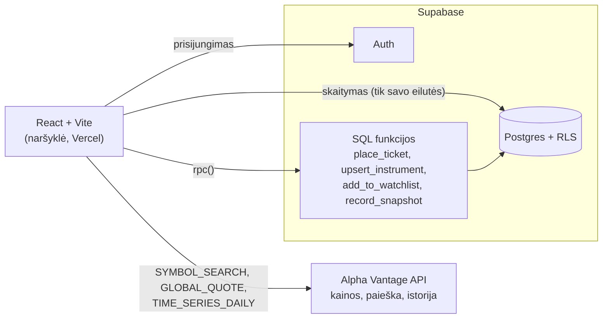

# Real Paper Trading Simulator

Akcijų prekybos simuliatorius: vartotojas gauna **$10,000 virtualų balansą**, ieško
akcijų, perka ir parduoda jas pagal **realias Alpha Vantage kainas**, o portfelis,
sandoriai ir rezultatai saugomi **Supabase** duomenų bazėje..

> Tai mokymosi projektas („21. Vibe coding finalas“), ne finansinė rekomendacija.

## Galimybės

| Ekranas | Kas jame yra |
|---|---|
| **Portfelis** | Pinigai, portfelio vertė, bendra vertė, pelnas / nuostolis; pozicijų lentelė su „Atnaujinti kainas“ ir paskutinio atnaujinimo laiku; portfelio vertės grafikas; stebimų akcijų sąrašas |
| **Prekyba** | Akcijų paieška pagal simbolį ar pavadinimą, dabartinė kaina ir pokytis, pirkimo / pardavimo forma, kainos grafikas (1 mėn. / 3 mėn. / viskas) |
| **Istorija** | Visi vartotojo sandoriai ir pelno / nuostolio grafikas su sandorių žymomis |
| **Prisijungimas / registracija** | Supabase Auth (el. paštas + slaptažodis) |

Trys grafikai remiasi tik realiais duomenimis:

1. **Akcijos kaina** – Alpha Vantage `TIME_SERIES_DAILY`.
2. **Portfelio vertė laike** – `portfolio_snapshots` lentelė DB.
3. **Pelnas / nuostolis laike** – tie patys snapshotai minus pradiniai $10,000, su pirkimų / pardavimų taškais iš `tickets`.

Visa vartotojo sąsaja yra lietuvių kalba.

## Architektūra



- **Frontend:** React 19 + Vite, be papildomų UI ar grafikų bibliotekų (grafikai – savas SVG komponentas `LineChart.jsx`).
- **Duomenų bazė:** Supabase Postgres su Row Level Security – kiekvienas vartotojas mato tik savo duomenis.
- **Prekybos logika** vyksta duomenų bazėje (`place_ticket`): vienoje transakcijoje patikrinami pinigai / akcijos, atnaujinamas balansas ir pozicija, įrašomas sandoris su kaina ir portfelio snapshotas. Naršyklė niekada nesiunčia `trader_id` – jis nustatomas pagal prisijungusį vartotoją.
- **Kainos:** Alpha Vantage atsakymai 5 min. saugomi atmintyje ir `localStorage`, užklausos siunčiamos ne dažniau kaip kas 1,2 s, o pasiekus limitą rodomas aiškus pranešimas.

### Duomenų bazė

| Lentelė | Paskirtis |
|---|---|
| `profiles` | Vartotojo profilis (sukuriamas automatiškai registruojantis) |
| `traders` | Prekybos paskyra: vardas, el. paštas, `cash_balance` (pradžioje 10 000) |
| `instruments` | Akcijos: simbolis, įmonė, paskutinė kaina, pokytis %, `updated_at` |
| `tickets` | Sandoriai: BUY / SELL, kiekis, **kaina sandorio metu**, data |
| `positions` | Kiek kiekvienos akcijos turima ir vidutinė kaina |
| `watchlist` | Stebimos akcijos |
| `portfolio_snapshots` | Portfelio vertė laike (grafikams) |

### Projekto struktūra

```
src/
  api/alphaVantage.js      visos Alpha Vantage užklausos, talpykla, limitai
  lib/                     Supabase klientas ir duomenų hook'ai (useAuth, usePortfolio, useWatchlist, ...)
  pages/                   Portfolio, Trade, History, Login, Register
  components/              StockSearch, TradeForm, Watchlist
  components/charts/       PriceChart, PortfolioValueChart, ProfitLossChart
  components/ui/           bendri UI komponentai (LineChart, Card, Table, ...)
  utils/                   formatavimas, grafikų pagalbinės funkcijos, klaidų vertimas
supabase/migrations/       duomenų bazės schema ir funkcijos
```

## Paleidimas lokaliai

Reikia **Node.js 20.19+** (arba 22+), Supabase projekto ir nemokamo
[Alpha Vantage API rakto](https://www.alphavantage.co/support/#api-key).

```bash
npm install
cp .env.example .env   # tada įrašykite savo reikšmes
npm run dev
```

`.env` kintamieji (failas į git nepatenka):

| Kintamasis | Kur rasti |
|---|---|
| `VITE_SUPABASE_URL` | Supabase → Project Settings → API → Project URL |
| `VITE_SUPABASE_PUBLISHABLE_KEY` | Supabase → Project Settings → API Keys → publishable key |
| `VITE_ALPHA_VANTAGE_KEY` | Alpha Vantage API raktas |

Kitos komandos: `npm run build` (produkcinė versija), `npm run preview`, `npm run lint`.

## Duomenų bazės paruošimas

SQL failai yra `supabase/migrations/`. Juos galima paleisti Supabase → **SQL Editor**.

- **Naujas Supabase projektas:** paleiskite abu failus iš eilės:
  1. `20261019000000_baseline.sql` – lentelės, RLS taisyklės, registracijos trigeris, `place_ticket`, `upsert_instrument`.
  2. `20261020120000_watchlist_and_snapshots.sql` – stebimų sąrašas, portfelio snapshotai, pokytis %, istorijos atkūrimas iš senų sandorių.
- **Esamas projektas** (kuriame jau yra lentelės): paleiskite **tik antrą failą**. Pirmojo
  nepaleiskite – jis grąžintų seną `upsert_instrument` versiją šalia naujos.

Supabase → Authentication → URL Configuration įrašykite svetainės adresą (lokaliai
`http://localhost:5173`, produkcijoje – Vercel adresą), kad patvirtinimo laiškų nuorodos veiktų.

## Diegimas (Vercel)

Projektas prijungtas prie Vercel: kiekvienas `master` šakos atnaujinimas automatiškai išdiegiamas.

1. Vercel → Project → Settings → Environment Variables – įrašykite tuos pačius tris `VITE_...` kintamuosius.
2. Pakeitus kintamąjį reikia naujo deploy (Vite reikšmes įrašo build metu).
3. Supabase Auth URL nustatymuose turi būti Vercel adresas.

## Žinomi apribojimai

- **Alpha Vantage nemokamas planas:** ~25 užklausos per dieną ir ~1 per sekundę. Lokali ir Vercel versijos su tuo pačiu raktu dalijasi tuo pačiu limitu.
- **Kainos atsinaujina pagal poreikį** (paieška, „Atnaujinti kainas“, prekyba), ne fone – kitaip limitas baigtųsi per kelias minutes. Paskutinio atnaujinimo laikas rodomas prie pozicijų ir stebimų akcijų.
- **API raktas matomas naršyklėje:** `VITE_` kintamieji patenka į viešą JavaScript kodą. Tikram paslėpimui reikėtų serverio funkcijos (pvz. Supabase Edge Function).
- **Kaina ateina iš naršyklės:** prieš sandorį naršyklė įrašo Alpha Vantage kainą per `upsert_instrument`, todėl techniškai vartotojas galėtų įrašyti netikrą kainą. Mokymosi projektui tai priimtina; produkcijoje kainą reikėtų gauti serveryje.
- Kainos rodomos JAV doleriais, kaip jas grąžina Alpha Vantage.
